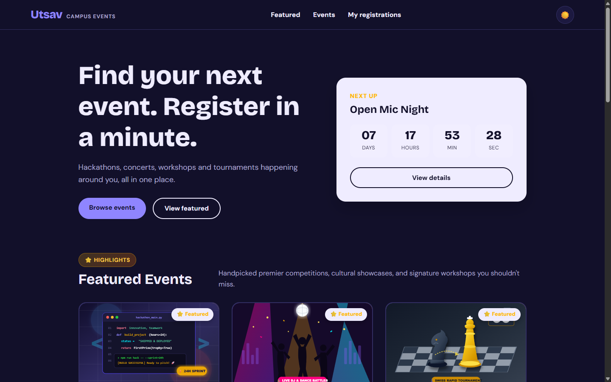
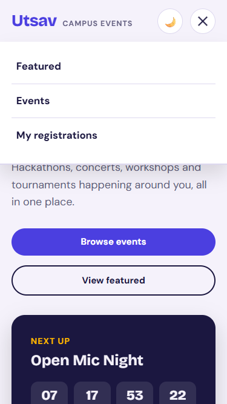
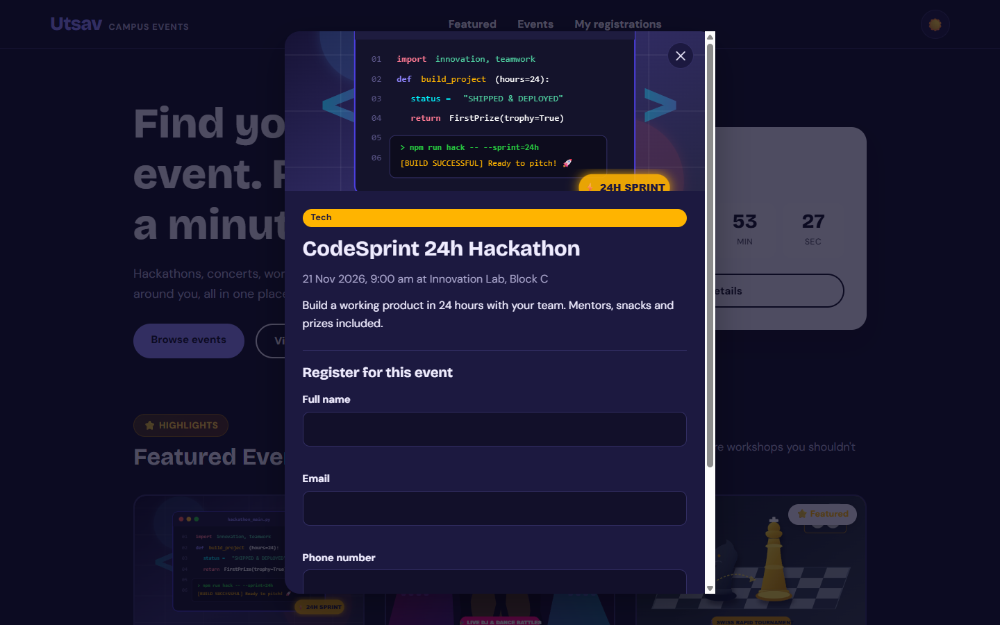
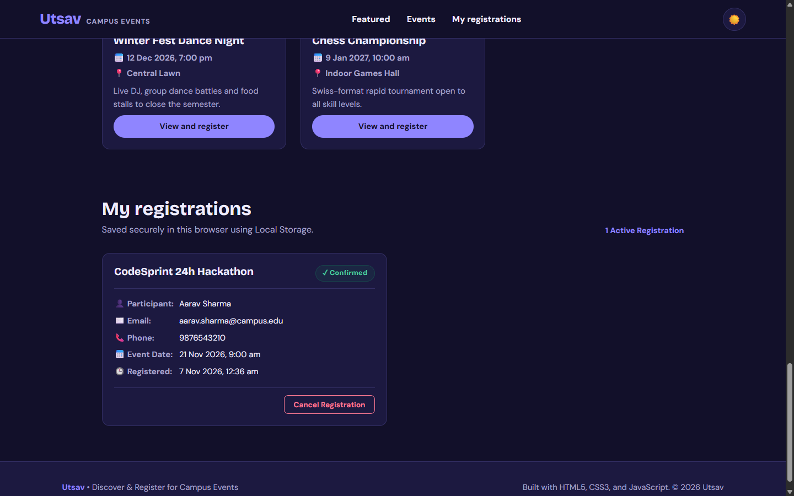

# Utsav: Event Management Website

A modern, responsive, and accessible web application designed to discover upcoming campus events, view comprehensive event details, and register in under a minute with local browser persistence.

---

## 1. Project Description

**Utsav** is a lightweight, frontend Event Management Website created to streamline campus life. Students and attendees can browse upcoming tech hackathons, cultural fests, workshops, and sports tournaments, filter events by category or live search keywords, view real-time countdown timers for the closest upcoming events, and complete instant event registrations.

All registrations are validated in real-time using JavaScript and saved locally using browser `localStorage`, ensuring complete offline persistence across page refreshes with zero external database dependencies.

---

## 2. Key Features

- **Responsive Navigation with Hamburger Menu:**
  - Accessible navigation links (`Featured`, `Events`, `My registrations`) across mobile, tablet, and desktop screens.
  - Interactive hamburger toggle menu with smooth animations and ARIA attributes for smaller devices (`<= 820px`).
  - Automatic menu close upon clicking a navigation link or clicking outside the menu.
  - Smooth in-page scrolling to sections (`#featured`, `#events`, `#registrations`).

- **Featured Events Section:**
  - Dedicated homepage showcase highlighting top flagship events across Tech, Cultural, and Sports categories.
  - Attractive event cards featuring badges (`⭐ Featured`), custom thematic illustrations, dates, venues, descriptions, and one-click registration buttons.

- **Curated Local Vector Imagery:**
  - Replaced generic placeholder / Picsum imagery with custom, high-resolution SVG illustrations for every event:
    - *Hackathons & Coding Competitions* (CodeSprint 24h Hackathon)
    - *Open Mic & Cultural Performances* (Open Mic Night)
    - *Technical Workshops & Bootcamps* (React Workshop, UI/UX Design Bootcamp)
    - *Sports & Athletics* (Inter-College Football Cup, Chess Championship)
    - *Keynote Talks & Conferences* (AI and Careers Talk)
    - *Festivals & Dance Battles* (Winter Fest Dance Night)
  - 100% locally hosted in `images/` directory for fast, offline, and reliable rendering without broken external links.

- **Upcoming Events with Live Search & Category Filtering:**
  - Real-time search across event titles, venues, categories, and descriptions.
  - Interactive category filter chips (`All`, `Tech`, `Cultural`, `Workshop`, `Sports`).
  - Helpful empty state when no matching events are found.

- **Live Countdown Timer:**
  - Real-time ticking countdown (Days, Hours, Minutes, Seconds) targeting the earliest upcoming campus event.

- **Event Details & Validated Registration Modal:**
  - Comprehensive event modal dialog displaying full details, banner image, date, venue, category, and description.
  - Accessible keyboard navigation (close on `Escape`, focus trap on open, Enter key support).
  - Robust client-side validation:
    - Full Name: letters, dots, hyphens, min 3 characters.
    - Email: standard RFC format verification.
    - Mobile Number: exactly 10 digits starting with 6, 7, 8, or 9.
  - Duplicate registration prevention (prevents registering the same email multiple times for the same event).
  - Instant confirmation message upon registration.

- **Enhanced "My Registrations" Dashboard:**
  - Card-based layout displaying:
    1. Participant Name
    2. Email Address
    3. Phone Number
    4. Event Name
    5. Event Date & Time
    6. Registration Timestamp
    7. Registration Status (`✓ Confirmed` badge)
  - Full `localStorage` persistence that remains intact across page refreshes.
  - Instant "Cancel Registration" functionality with immediate UI and storage updates.
  - Graceful fallback for legacy records.

- **Dark / Light Theme Toggle:**
  - One-click theme switcher (`☀️` / `🌙`) respecting user preferences and system settings (`prefers-color-scheme`).
  - Choice persisted in browser `localStorage`.

- **Accessibility & Performance:**
  - Semantic HTML5 landmark tags (`<header>`, `<main>`, `<nav>`, `<section>`, `<article>`, `<aside>`, `<footer>`).
  - WCAG-compliant color contrast ratios and keyboard focus rings.
  - Full support for `prefers-reduced-motion`.

---

## 3. Technologies Used

- **HTML5:** Semantic markup, dialogs, form input types, and accessibility roles.
- **CSS3:** Flexbox, CSS Grid, Custom Properties (CSS variables for theming), media queries, transitions, and keyframe animations.
- **Vanilla JavaScript (ES6+):** DOM manipulation, event listeners, regex validation, array filtering, timers, and Web Storage API (`localStorage`).
- **No external frameworks or runtime dependencies:** Pure web standards for maximum speed, portability, and zero build requirements.

---

## 4. Project Folder Structure

```
utsav/
├── index.html              # Main single-page application structure
├── README.md               # Project documentation and guide
├── css/
│   └── style.css           # Global stylesheets, responsive layouts & themes
├── js/
│   ├── data.js             # Event data array with local image paths & flags
│   └── app.js              # Core logic: navigation, search, modal, validation, storage
└── images/                 # Curated local vector SVG illustrations
    ├── ai-talk.svg         # AI and Careers Talk artwork
    ├── chess.svg           # Chess Championship artwork
    ├── dance-night.svg     # Winter Fest Dance Night artwork
    ├── design-bootcamp.svg # UI/UX Bootcamp artwork
    ├── football.svg        # Inter-College Football Cup artwork
    ├── hackathon.svg       # CodeSprint Hackathon artwork
    ├── open-mic.svg        # Open Mic Night artwork
    └── react-workshop.svg  # React Workshop artwork
```

---

## 5. Installation and Setup Instructions

### Prerequisites
- Any modern web browser (Google Chrome, Mozilla Firefox, Microsoft Edge, Safari, Brave).
- No Node.js, npm, or database setup is strictly required.

### Setup
1. Clone or download the repository to your local computer:
   ```bash
   git clone [GitHub Repository URL]
   cd utsav
   ```
2. Ensure all project files and the `images/` directory are intact.

---

## 6. How to Run the Project

You can run Utsav using any of the following simple methods:

### Method 1: Direct Browser Launch
- Double-click `index.html` or open it directly in your web browser (`file:///path/to/utsav/index.html`).

### Method 2: Python Built-in HTTP Server (Recommended)
Open a terminal in the project directory and run:
```bash
python -m http.server 8000
```
Then visit `http://localhost:8000` in your browser.

### Method 3: VS Code Live Server Extension
1. Open the project folder in Visual Studio Code.
2. Right-click `index.html` and click **"Open with Live Server"**.

---

## 7. Screenshots

### Desktop View (Homepage & Featured Events)
```markdown

*Homepage featuring header navigation, dark mode toggle, next event countdown timer, and the new Featured Events showcase.*
```

### Mobile View (Responsive Hamburger Navigation)
```markdown

*Mobile view (375px/425px) showing the animated hamburger menu, accessible navigation drawer, and responsive cards.*
```

### Event Details & Registration Form Modal
```markdown

*Event details dialog with full description and validated registration form.*
```

### My Registrations Section
```markdown

*Local storage-backed participant registrations with complete details, confirmation badges, and cancellation capability.*
```

---

## 8. GitHub Repository & Live Demo

- **GitHub Repository:** `[GitHub Repository URL]`
- **Live Demo Deployment:** `[Live Deployment URL]`

---

## 9. Author Information

- **Student Name:** `[Your Name]`
- **GitHub Username:** `[Your GitHub Username]`
- **Course / Assignment:** College Web Designing Assignment
